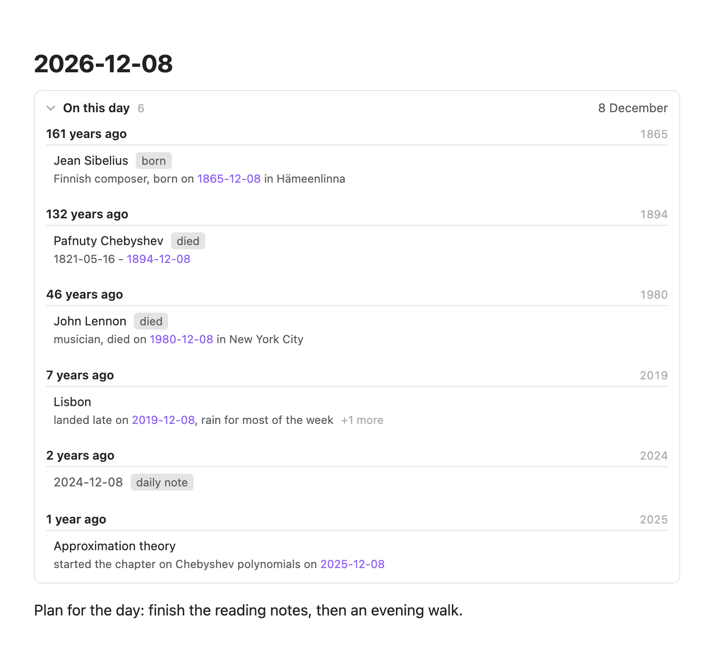
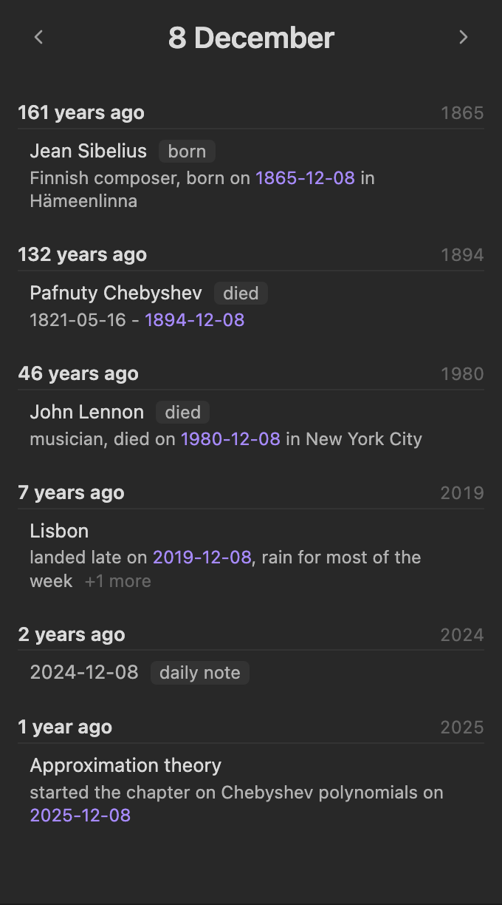
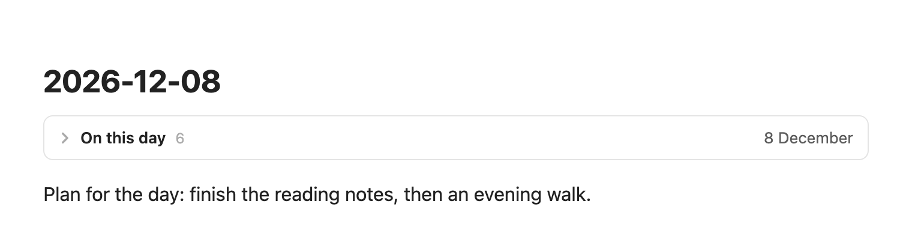

# Recurrent Dates

[](https://github.com/kenkyuusha/recurrent-dates/actions/workflows/ci.yml)
[](LICENSE)

An [Obsidian](https://obsidian.md) plugin that shows what happened **on this
day** in any year, using the date links you already have in your notes.

Say a note about a mathematician contains the line
`[[1821-05-16]] - [[1894-12-08]]`. Every 8 December, Recurrent Dates lists
that note with a **died** badge and the number of years that have passed
("132 years ago" in 2026). Every 16 May it lists the same note with a **born**
badge. Nothing had to be tagged, reformatted or entered anywhere else: the two
links were enough.



> **Available in Obsidian's community directory:**
> [Recurrent Dates](https://community.obsidian.md/plugins/recurrent-dates).
> See [Installing](#installing).

## Contents

- [Why you might want it](#why-you-might-want-it)
- [Quick start](#quick-start)
- [What the list shows](#what-the-list-shows)
- [The sidebar panel](#the-sidebar-panel)
- [The code block](#the-code-block)
- [How dates are recognized](#how-dates-are-recognized)
- [Births and deaths](#births-and-deaths)
- [Settings](#settings)
- [Languages](#languages)
- [Privacy and performance](#privacy-and-performance)
- [Installing](#installing)
- [Troubleshooting](#troubleshooting)
- [Limitations](#limitations)
- [Development](#development)
- [License](#license)

## Why you might want it

- **No setup and no new syntax.** If you link dates as `[[1894-12-08]]`, you
  already have the data. There are no properties to fill in and no separate
  list of anniversaries to maintain.
- **The whole vault is the source.** A birthday in a note about a person, the
  day a project started, the date of a trip, a line in an old meeting note:
  anything that links to a date comes back on that day in later years.
- **It understands a little context.** Births and deaths are marked, and the
  links that daily notes use to point at yesterday and tomorrow are left out.
- **Two places to see it.** A sidebar panel, and a block you can embed in any
  note, such as your daily note. Both work on desktop and on mobile.
- **Read-only and local.** The plugin never changes your notes and makes no
  network requests.

It complements plugins that review past daily notes or keep a dedicated list of
birthdays: instead of a separate place for dates, it reads the ones that are
already scattered through ordinary notes.

## Quick start

1. Install and enable the plugin (see [Installing](#installing)).
2. Look at the right sidebar: the first time the plugin runs on a device it
   adds an **On this day** tab there. You can also run **Recurrent Dates: Open
   on this day** from the command palette or select the calendar-with-clock
   icon in the ribbon.
3. Keep linking dates the way you do now, for example
   `Jean Sibelius was born on [[1865-12-08]]`. From then on that note shows up
   every 8 December.
4. Optional: add the block below to your daily note template, so every daily
   note shows its own day.

   ````markdown
   ```recurrent-dates
   ```
   ````

## What the list shows

For the selected day the list has one group per year, labelled with how long
ago that was ("161 years ago") and the year itself. Each entry has:

- **The note's name.**
- **A badge** when the plugin knows more: **born**, **died**, or **daily
  note** for a note that is itself named after this day in another year.
- **The line the link sits on**, with the date highlighted. Markdown is
  cleaned up so the line reads like text, and long lines are shortened around
  the date.
- **"+1 more"** when further lines of the same note link to the same date. A
  note appears once per date, however often it mentions it.

Years run from the oldest to the newest; a setting reverses that. Inside a
year, births come first, then deaths, then other entries, then daily notes.

The age is counted from the current year. A date in the current year reads
"this year". If you switch on future years, a date that is still ahead reads
"in 3 years".

Opening a note from the list works like any link in Obsidian:

| Action | Result |
| --- | --- |
| Select an entry (click, tap, or Enter when it has focus) | Opens the note at that line |
| Ctrl/Cmd + click, or middle click | Opens it in a new tab |
| Hold Ctrl/Cmd and hover | Shows a preview, if the Page preview core plugin is on |

In the Page preview settings the list appears as "On this day (panel)" and
"On this day (block)", where you can choose whether the modifier key is
needed.

## The sidebar panel



- **Opening it.** The plugin adds the panel to the right sidebar once, the
  first time it runs on a device. After that it is yours to move or close; it
  is not added again. To bring it back, run **Recurrent Dates: Open on this
  day** or use the ribbon icon.
- **Following today.** The panel shows today and moves on to the next day by
  itself after midnight.
- **Browsing.** The arrows step to the previous and the next day. While you
  are on another day, a **Today** link takes you back.
- **Staying current.** When you add, change, rename or delete notes, the list
  updates within about half a second.
- **On phones** the panel lives in the right drawer. Selecting an entry opens
  the note and closes the drawer.

## The code block

Put this in any note to embed the same list:

````markdown
```recurrent-dates
```
````

It renders in Reading view and in Live Preview.

**Which day it shows.** In a note whose name is a date, such as a daily note,
the block shows that note's day. Anywhere else it shows today and follows it.
The note that contains the block is never listed in its own block.

**Options.** Write one `key: value` pair per line inside the block:

| Option | Example | Meaning |
| --- | --- | --- |
| `date` | `date: 12-08` | Always show 8 December, whatever the note is called |
| `date` | `date: 1894-12-08` | Show 8 December as seen from 1894: ages are counted from that year |
| `collapsed` | `collapsed: true` | Start folded. The default is `false` |

For example, a block pinned to one day that starts folded:

````markdown
```recurrent-dates
date: 12-08
collapsed: true
```
````

If an option cannot be read, the block says so instead of showing a list, for
example `Unknown option: sort: newest` or `Not a date: tomorrow`.

**Collapsing.** The block's header is a button with Obsidian's usual fold
arrow. Select it, or press Enter or Space when it has focus, to fold the list
away. The header keeps showing how many entries the day has.



Each device remembers the state per note, so a block can stay folded on your
desktop and open on your phone. A new daily note starts in the state its
`collapsed` option names, expanded when there is none. The state is kept
locally and is not synced.

## How dates are recognized

A date is a link to a note whose name is a date in your date format
(`YYYY-MM-DD` unless you change it). All of these count:

| You write | What is read |
| --- | --- |
| `[[1894-12-08]]` | 8 December 1894 |
| `[[daily/1894-12-08]]` | The same: folders are ignored |
| `[[1894-12-08\|8 Dec 1894]]` | The same: the alias is what the list shows |
| `[[1894-12-08#Evening]]` | The same: headings and block references are ignored |
| `died: "[[1894-12-08]]"` in properties | The same: the property name is used as the label |

The dated note does not have to exist. A link to a note you never created
counts too.

Dates written as plain text, without the double brackets, are not picked up.

### What is left out on purpose

- **Navigation between daily notes.** In a note named after a date, a line
  that links to that same day or to the day before or after it, and holds no
  more than 24 other letters or digits, is treated as navigation and ignored.
  That covers lines like `<< [[2024-01-01]] | [[2024-01-03]] >>` and
  `Yesterday: [[2024-01-01]] Tomorrow: [[2024-01-03]]`. A real sentence that
  mentions yesterday is longer than that and is kept.
- **Bookkeeping lines.** A line written as `label: [[date]]` is skipped when
  the label is on the ignore list: `created`, `date added`, `saved`,
  `modified` and similar by default. Case, emphasis and list markers do not
  matter, so `- **Created**: [[2024-01-05]]` is skipped too. The label is the
  whole text before the colon. The same list applies to property names.
- **Excluded folders**, if you name any in the settings.
- **Future years**, unless you turn them on.
- **Empty daily notes.** A note named after the day in another year is listed
  as a **daily note** entry only if it holds something besides properties,
  navigation lines and this plugin's own block.

### Leap day

Entries for 29 February appear on 28 February in years that have no leap day.

## Births and deaths

A date gets a **born** or **died** badge in one of two ways.

**By a keyword before it on the same line.** If words such as "born" or
"died" stand between the previous date link and this one, the one closest to
the date decides. Keywords match whole words only, so "rebirth" and
"birthplace" do not count as "birth". Keywords in scripts that do not separate
words, such as Japanese, match anywhere. For a link in properties, the
property name is checked instead.

**As a lifespan.** Without a keyword, two date links joined by nothing but a
dash (a hyphen, an en dash or an em dash) and 1 to 125 years apart are read as
a birth followed by a death. This can be switched off.

Anything else is a plain entry without a badge.

| Line in a note | Result |
| --- | --- |
| `Finnish composer, born on [[1865-12-08]] in Hämeenlinna` | born |
| `musician, died on [[1980-12-08]] in New York City` | died |
| `[[1821-05-16]] - [[1894-12-08]]` | born on 16 May, died on 8 December |
| `Pafnuty Chebyshev ([[1821-05-16]] – [[1894-12-08]])` | the same |
| `died young; her daughter was born [[1990-07-04]]` | born: the nearest keyword wins |
| `trip: [[2012-01-02]] - [[2012-01-10]]` | two plain entries: too short for a lifespan |

The default keywords cover English, Russian and Japanese. You can replace or
extend both lists in the settings.

## Settings

| Setting | Default | What it does |
| --- | --- | --- |
| Date format | `YYYY-MM-DD` | How dates are written in link targets and note names, as a [Moment.js pattern](https://momentjs.com/docs/#/displaying/format/). Use the same format as your daily notes |
| Show daily notes from other years | on | Lists notes named after this day in other years, unless they hold only navigation |
| Show future years | off | Includes dates in years after the current one |
| Newest year first | off | Puts the most recent year at the top |
| Ignored labels | `created, date created, created date, date added, added, saved, updated, modified, date modified` | Labels of `label: [[date]]` lines to skip. Separate them with commas or new lines |
| Excluded folders | none | Folders whose notes are left out, one per line |
| Read date pairs as lifespans | on | Treats `[[date]] - [[date]]` as a birth and a death when the dates are 1 to 125 years apart |
| Birth keywords | `born, birth, birthday, родился, родилась, рождение, рождения, 生まれ, 誕生` | Words that mark the date after them as a birth |
| Death keywords | `died, death, умер, умерла, скончался, скончалась, смерть, смерти, погиб, погибла, 死去, 逝去` | Words that mark the date after them as a death |

Changes apply at once. Changing the date format rebuilds the index.

## Languages

The panel title, the age wording ("132 years ago") and the badges follow
Obsidian's interface language for English and Russian. Other languages fall
back to English. The settings tab is in English.

## Privacy and performance

- **No network.** The plugin makes no requests and collects nothing.
- **No changes to notes.** It only reads.
- **What it stores.** Its settings, in the plugin's `data.json`. On each
  device, in Obsidian's local storage: which blocks you folded, and a flag
  that the panel was already added to the sidebar.
- **What it reads.** To build its index the plugin goes through every Markdown
  note in the vault, but only through what Obsidian already keeps in memory
  about it: its name and the positions of its links. Starting the plugin does
  not read your files. The text of a note is read only when that note has
  something on the day being shown.

## Installing

Recurrent Dates needs Obsidian 1.8.7 or newer and works on desktop and
mobile. So far it has been run on Obsidian 1.15 on macOS and iOS. It uses no
platform-specific APIs, so other platforms should behave the same; reports
are welcome.

### From the community directory

1. In Obsidian, open **Settings → Community plugins** and turn off Restricted
   mode if it is on.
2. Select **Browse** and search for **Recurrent Dates**. You can also open the
   plugin's [directory page](https://community.obsidian.md/plugins/recurrent-dates)
   and select **Add to Obsidian**.
3. Select **Install**, then **Enable**.

### From a release

1. Open the [latest release](https://github.com/kenkyuusha/recurrent-dates/releases/latest)
   and download `main.js`, `manifest.json` and `styles.css`.
2. Create the folder `<your vault>/.obsidian/plugins/recurrent-dates/` and put
   the three files in it.
3. In Obsidian, open **Settings → Community plugins**, turn off Restricted
   mode if it is on, reload the list of installed plugins and enable
   **Recurrent Dates**.

### From source

You need [Node.js](https://nodejs.org) 22 or newer and git.

```bash
git clone https://github.com/kenkyuusha/recurrent-dates.git
cd recurrent-dates
npm install
npm run build
```

The build writes `main.js` next to `manifest.json` and `styles.css` in the
repository folder. Continue from step 2 above with those three files.

### On your phone

Community plugins are installed on each device. Install Recurrent Dates from
the directory on the phone as well. If you installed it by hand, the plugin's
folder has to reach the phone the same way the rest of your vault does; after
it has synced, enable **Recurrent Dates** under **Settings → Community
plugins** on the phone and restart Obsidian.

## Troubleshooting

**The block shows up as plain code.** The plugin is not running on that
device. Check that its files have synced, that it is enabled there under
Community plugins, and restart Obsidian.

**The search in Obsidian does not find the plugin.** Open its
[directory page](https://community.obsidian.md/plugins/recurrent-dates) and
select **Add to Obsidian**, or install it from a release as described above. A
plugin installed by hand appears under **Installed plugins**.

**A date I linked does not show up.** Check, in this order:

1. It is a link (`[[1894-12-08]]`), not plain text.
2. The link's note name matches the **Date format** setting.
3. The line is not a `label: [[date]]` line whose label is on the **Ignored
   labels** list.
4. The note is not in an **Excluded folder**.
5. The year is not in the future, or **Show future years** is on.
6. The line is not a short line in a daily note that links to the day itself
   or a neighbouring day.
7. You are not looking at the block inside the very note that holds the link:
   a block never lists its own note.

**A daily note from another year is missing.** Notes that hold only
navigation links, properties or this plugin's block are not listed.

**The born or died badge is wrong or missing.** The keyword has to stand
before the date on the same line, after any earlier date link. Add your own
words to **Birth keywords** or **Death keywords**. If a pair of dates is
wrongly read as a lifespan, turn off **Read date pairs as lifespans**.

**The panel is gone.** Run **Recurrent Dates: Open on this day** from the
command palette.

## Limitations

- Only links are read. Dates written as plain text are not recognized.
- The date format applies to the note name only. Formats that spread a date
  over folders, such as `YYYY/MM/DD`, are not supported.
- One date format at a time.
- Interface text is available in English and Russian.
- The plugin does not add markers to calendar plugins.

## Development

```bash
npm install
npm run dev     # watch and rebuild main.js
npm test        # unit tests for the date logic
npm run lint    # Obsidian's ESLint rules
npm run build   # type-check and produce a production main.js
```

The date logic lives in `src/core`, has no dependency on Obsidian and is
tested in plain Node with Vitest. The Obsidian layer (`src/main.ts`,
`src/indexer.ts`, `src/settings.ts`, `src/ui/`) is kept thin. See
[the architecture notes](docs/SoT%20recurrent-dates%2013112026.md) for how the
pieces fit together and which rules are covered by tests.

Test data is invented or refers to well-known public facts. Please do not
paste lines from real notes into tests or issues.

Bug reports and pull requests are welcome. [CONTRIBUTING.md](CONTRIBUTING.md)
says what a useful report contains, what a change needs, and how releases are
cut.

## License

[MIT](LICENSE)
